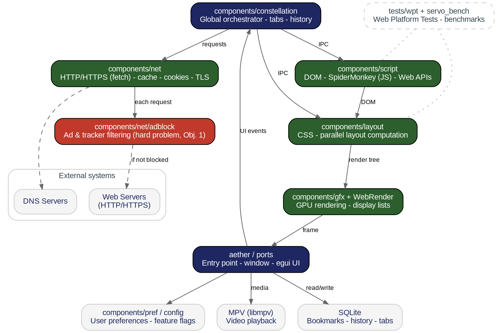

# **Introduction**

This document covers mandatory objective #2 of the Technical Track (Tech4): structuring, documenting and making Aether\'s technical architecture reliable. It reflects the current, confirmed architecture, Rust, pure Servo, egui, as defined in the Action Plan (§2.1, §2.2), and is written to be reviewed with the mentor (Jean-Philippe Roze).

Status: initial draft. The diagram and data model correspond to the deliverable due end of November 2026; the pipeline, tests, code review and reproducibility sections are outlined and will be completed at the deadlines in the calendar.

# **Part 1: Overview & technology stack**

## **1.1 Technology stack**

  --------------------------------------------------------------------------------------------------------------------------------------------------------------------------------------------
  **Component**          **Technology**                                              **Justification**
  ---------------------- ----------------------------------------------------------- ---------------------------------------------------------------------------------------------------------
  Language               Rust (stable)                                               Compile-time memory safety, no garbage collector, native performance

  Rendering engine       Servo                                                       Rust-based HTML/CSS engine, avoids a Chromium/Gecko dependency

  Graphical interface    egui                                                        Immediate-mode Rust GUI, lightweight and cross-platform

  Video playback         MPV (libmpv)                                                Mature player, broad codec support, native integration possible

  Ad/tracker filtering   adblock-rust, leading candidate (see Obj. 1 hard problem)   Mature, high-performance filtering engine; avoids rebuilding a specialized matching engine from scratch

  Build & packaging      Cargo                                                       Native tooling of the Rust ecosystem

  CI/CD                  GitHub Actions                                              Cross-platform continuous integration (Linux, Windows first; macOS later depending on budget)

  Tests                  cargo test + Web Platform Tests (WPT)                       Native unit tests + conformance to web standards

  Quality / linting      Clippy + rustfmt                                            Static analysis and standard Rust formatting

  Local storage          SQLite                                                      Bookmarks, history, tabs - embedded, zero-configuration

  App storage            IndexDB                                                     Storage for web app
  --------------------------------------------------------------------------------------------------------------------------------------------------------------------------------------------

## 

## 

## 

## 

## 

## 

## 

## 

## **1.2 Component architecture**

Aether builds on Servo\'s internal structure, organized as a network of independent, highly concurrent Rust crates. Each key process is isolated to maximize performance, memory safety and parallelism:

{width="5.833333333333333in" height="3.75in"}

*Figure 1 - Overview of Aether\'s components and their interactions*

  -----------------------------------------------------------------------------------------------------------------------------------------------
  **Component**                        **Responsibility**
  ------------------------------------ ----------------------------------------------------------------------------------------------------------
  aether / ports                       Application entry point, window lifecycle, egui interface (address bar, tabs, panels)

  components/constellation             Central orchestrator: global state, history, tab creation/destruction, async coordination between layers

  components/script                    DOM tree, web storage, JavaScript execution (SpiderMonkey), Web APIs

  components/layout                    CSS parsing and layout computation, heavily parallelized

  components/gfx + WebRender           Translates the render tree into GPU display commands

  components/net                       HTTP/HTTPS requests (fetch), cache, cookies, TLS negotiation

  components/net/adblock               Request filtering (ads/trackers), hard problem of Objective 1

  components/pref / config             Engine configuration, feature flags, user preferences

  tests/wpt + components/servo_bench   Web Platform Tests, visual regression tests, performance benchmarks
  -----------------------------------------------------------------------------------------------------------------------------------------------

## **1.3 Identified points of failure**

  ---------------------------------------------------------------------------------------------------------------------------------------------------------------------------
  **Scenario**                                           **Impact**                                                     **Planned mitigation**
  ------------------------------------------------------ -------------------------------------------------------------- -----------------------------------------------------
  A renderer process crashes (one tab)                   Only that tab crashes, the rest of the browser keeps running   Multi-process isolation (Servo architecture)

  An external service is unreachable (DNS, web server)   Only the affected page fails to load                           Timeout + error message, no global blocking

  Doubled load (e.g. 20 simultaneous tabs)               Progressive performance degradation (memory/CPU)               To validate with a load test, see Objective D

  The net/adblock component fails or slows down          Requests go unfiltered, or page loading slows down             To define with the decision prototype (Objective 1)
  ---------------------------------------------------------------------------------------------------------------------------------------------------------------------------

## **1.4 Data model (local SQLite storage)**

Schema carried over from the initial Technical & Functional Specifications (§2.1), it is independent from the rendering engine choice, so it remains valid, but has not yet been formally re-confirmed in the current Action Plan.

  --------------------------------------------------------------------------------------------
  **Table**     **Main columns**                          **Purpose**
  ------------- ----------------------------------------- ------------------------------------
  bookmarks     id, title, url, folder_id, created_at     Bookmarks, hierarchy via folder_id

  history       id, url, title, visit_count, last_visit   Browsing history

  tabs          id, session_id, url, title, position      Session/tab restoration

  settings      key, value, updated_at                    User preferences
  --------------------------------------------------------------------------------------------

# 

# **Part 2: Architecture Decision Record (ADR)**

Format used for every entry: date, context, options considered, decision, reason, consequences accepted. ADRs live on the GitHub wiki and feed this document at every structuring decision (4 minimum required, including at least one revised during the year).

### **ADR-001 - Rust as the core language**

- Context: need for memory safety and performance in a browser, without the classic pitfalls of C/C++.

- Options considered: C++ (memory-safety risk), Go (garbage-collector overhead), Rust.

- Decision: Rust for the entire core logic.

- Consequences: a learning curve for the team, a smaller ecosystem than C++.

### **ADR-002 - Servo as the rendering engine**

- Context: need for a Rust-native rendering engine, avoiding a dependency on Chromium or Gecko.

- Options considered: Servo (Rust, experimental but actively developed), embedding an existing production engine.

- Decision: Servo.

- Consequences: some web-standard coverage gaps compared to fully mature engines, but full alignment with the all-Rust strategy (ADR-001) and no dependency on an external engine\'s release cycle.

### **ADR-003 - No Chromium fork**

- Context: Chromium offers a mature base but is tightly coupled to Google\'s ecosystem.

- Options considered: forking Chromium (as Brave/Edge do), building from scratch.

- Decision: build from scratch, no Chromium fork.

- Consequences: longer development time, web-compatibility challenges, but full control and a cleaner codebase.

### **ADR-004 - egui for the graphical interface**

- Context: need for a UI toolkit consistent with an all-Rust stack.

- Options considered: egui (immediate-mode, pure Rust), other Rust GUI frameworks (e.g. Slint, considered for a future mobile version).

- Decision: egui for desktop.

- Consequences: a smaller UI ecosystem than mainstream toolkits, but no external UI dependency and simpler builds.

# 

# 

# **Part 3: Technical documentation**

To write directly in the repository (not in this summary document), first version due end of December 2026:

- README: purpose of the project, prerequisites, installation, configuration, environment variables, main commands, folder structure, how to run tests.

- API documentation: exposed endpoints/extension API, expected parameters, response formats, error codes, example calls.

- Operations documentation: log locations, restart procedure, what to do when something common breaks.

# **Part 4: CI pipeline & code quality**

## **4.1 Continuous integration pipeline**

- GitHub Actions, running automatically on every commit/PR: clippy (lint), rustfmt (formatting), cargo test, build.

- Automated nightly builds planned (00:00 UTC) to catch regressions early, per the Action Plan (LLR-005).

- Merges blocked on the main branch on failure.

## **4.2 Code quality**

Tools selected: Clippy (static analysis) + rustfmt (formatting). Baseline measurement in December 2026, final measurement in May 2027.

  -----------------------------------------------------------------------------------------
  **Measurement**                     **December 2026 (baseline)**   **May 2027 (final)**
  ----------------------------------- ------------------------------ ----------------------
  Number of clippy warnings           To measure                     To measure

  Number of formatting errors         To measure                     To measure
  -----------------------------------------------------------------------------------------

- Clippy rules disabled, and why: to document as they come up.

- Technical debt: list to maintain continuously on the wiki (what should be fixed, why it hasn\'t been, rough cost).

# **Part 5: Tests**

Proposed critical path (the flow whose failure makes the product unusable): URL entry → network request → adblock filtering → rendering → display. To validate as a team.

- Automated tests on this critical path, run in the CI, due end of March 2027.

- At least one integration test covering a full flow (not an isolated function).

- Coverage report, with the share corresponding to the critical path.

- At least 3 regressions caught by tests, documented (what broke, which test, when), to track throughout the year.

# **Part 6: Code review**

- No merge to the main branch without review by another team member.

- Target: at least 15 pull requests reviewed over the year, spread across the team.

- At least 3 cases where a review led to a change before merging, to document.

# **Part 7: Deployment reproducibility**

- The project must be installable and runnable by someone outside the team.

- Automated procedure envisioned: Cargo install script + per-OS instructions (Windows/Linux first, per the Action Plan).

- Reproducibility test by an external person to schedule before end of March 2027 (duration, blockers, documentation fixes made as a result to be logged).

- Configuration kept out of the code: environment variables, no secrets in the repository.

*Document Date: September 16, 2026*\
*Modify Date: September 16, 2026*
